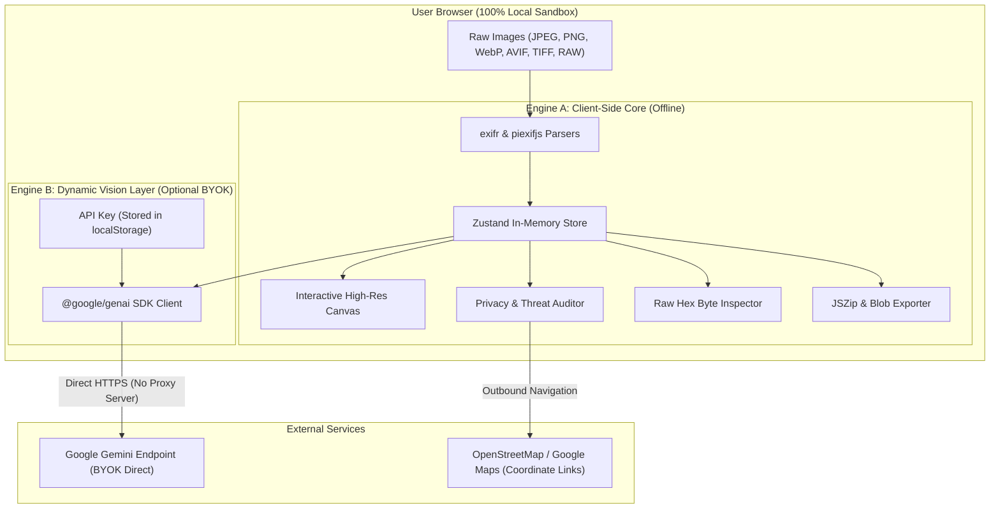

# METAFORGE PRO

> **Inspect. Clean. Enrich. Publish.**
> The High-Throughput In-Browser Image Metadata Studio, Privacy Sanitizer, and Dynamic AI SEO Engine.

[](https://nextjs.org/)
[](https://www.typescriptlang.org/)
[](https://tailwindcss.com/)
[](#-architecture-dual-engine--zero-server-uploads)
[](https://aistudio.google.com/)
[](LICENSE)

---

## ⚡ Architecture: Dual-Engine & Zero-Server Uploads

MetaForge eliminates the classic **"ExifTool + Serverless" bottleneck**. Traditional serverless functions fail when running heavy binary EXIF tools due to container spin-up latencies, cold starts, and AWS Lambda's 50MB payload limits.

MetaForge implements an edge-ready, client-first dual-engine design:



### 1. Engine A: In-Browser Client Core (WebAssembly & Memory Blobs)
- **Zero-Upload Privacy:** 100% of EXIF, IPTC, XMP, GPS, and MakerNotes parsing, stripping, and editing executes directly in client browser memory. Images never touch an external server or database.
- **Zero Hosting Overhead:** Zero serverless function invocation costs, zero cloud storage bandwidth fees, and zero server-side cold starts.
- **Instant Processing:** In-memory byte array mutations deliver sub-10ms response times for metadata modifications and instant local exports.

### 2. Engine B: Dynamic AI Layer (Google Gemini BYOK)
- **100% Offline Capability:** When AI is disabled via the header toggle, MetaForge operates in complete isolation with zero network requests.
- **Direct Edge Execution:** When enabled, requests route directly from the browser to Google Gemini API (`gemini-2.5-flash`, `gemini-1.5-flash`, `gemini-1.5-pro`) using Bring-Your-Own-Key (BYOK). Keys remain safely in your browser's `localStorage` and are never shared or logged.

---

## 📱 Three Purpose-Built Responsive Experiences

MetaForge adapts its layout and interaction model to each screen class rather than scaling down desktop components:

```
Desktop (≥ 1200px)           Tablet (768px – 1199px)           Mobile (< 768px)
┌─────┬───────┬───────┐      ┌───────────┬───────────────┐      ┌─────────────────────────┐
│Queue│Canvas │ Studio│      │ Canvas    │ Tabbed        │      │ ← Asset Name (1/12)   → │
│     │ & Tag │ Tools │      │ & Gallery │ Inspector     │      ├─────────────────────────┤
│     │ Tree  │       │      │ (42% Split│ (58% Split)   │      │ [Canvas|Tags|Priv|SEO]  │
│     │       │       │      │           │               │      ├─────────────────────────┤
│     │       │       │      │           │               │      │ Active Segment Panel    │
└─────┴───────┴───────┘      └───────────┴───────────────┘      ├─────────────────────────┤
                                                                │ [Home|Studio|Comp|More] │
                                                                └─────────────────────────┘
```

- **Desktop (≥ 1200px):** 3-column workstation layout featuring independent scroll panes (File Queue, Center Canvas/Metadata Tree, Right-hand Studio Suite for SEO and Privacy).
- **Tablet (768px – 1199px):** 2-column split layout with left-hand canvas/gallery and right-hand tabbed inspector, complete with collapsible icon sidebar rail.
- **Mobile (< 768px):** Native mobile productivity layout with iOS/Android safe area support, 48px minimum touch targets, horizontal segmented tab switcher, swipe gesture navigation, and persistent bottom bar.

---

## 🚀 Key Feature Matrix

| Module | Features & Capabilities |
| :--- | :--- |
| **Deep Metadata Explorer** | Full tree view for File Info, EXIF 2.32, IPTC Dublin Core, and XMP packets. Real-time tag filtering, inline editing, addition of arbitrary custom tags, tag deletion, and clipboard value copy. |
| **Privacy Threat Auditor** | Real-time Threat Index (0–100) scoring. Automatic leak detection for GPS coordinates, camera serial numbers, and software hostnames. Direct links to Google Maps & OpenStreetMap, one-click coordinate copy, and lossless GPS scrubbing. |
| **AI Workflow Decoder** | Deep inspection of PNG text chunks (`tEXt`, `zTXt`, `iTXt`) and EXIF `UserComment`. Auto-detects ComfyUI node graphs, Stable Diffusion (Automatic1111 / Forge), and Midjourney prompts, samplers, seeds, steps, CFG scale, and base models. |
| **Gemini Vision SEO Suite** | Vision-assisted extraction of search-optimized Titles, WCAG-accessible Alt Text for screen readers, Editorial Captions, and keyword tags. Direct writeback into IPTC/EXIF headers. |
| **Search & Social Simulator** | Live previews for Google Search results, Twitter / X summary large image cards, and OpenGraph (Facebook / LinkedIn) social shares. |
| **Image Sitemap Builder** | Dynamic generation and export of standard-compliant Google Image Sitemap XML (`image-sitemap.xml`) files. |
| **Metadata Comparator** | Side-by-side comparison of any two image assets. Visual diff highlighting, bidirectional field copying (Asset A &harr; Asset B), and instant editing. |
| **Presets Manager** | Custom preset configurations for SEO Web, Pro Photography, E-Commerce Catalogs, and OPSEC Privacy. Batch application across files, plus full JSON import and export capability. |
| **Batch Automation Queue** | Asynchronous background task monitor. Batch "Strip All GPS", "Batch Sanitize for Social Media", and multi-file `.zip` archive generation via `JSZip`. |
| **High-Res Canvas Preview** | Pan and zoom controls (50% to 400%), checkerboard transparency grid, inline filename renaming, touch swiping, and history snapshot rollback. |
| **Raw Hex Stream Viewer** | Raw byte inspection of the first 4KB header with hex addresses, byte values, and ASCII representation for binary format inspection. |

---

## ⌨️ Keyboard Shortcuts Reference

MetaForge features native keyboard shortcuts for power-user workflows:

| Shortcut | Action | Scope |
| :--- | :--- | :--- |
| `→` or `]` | Next Image in Queue | Global Studio |
| `←` or `[` | Previous Image in Queue | Global Studio |
| `⌘K` or `Ctrl+K` | Open Command Palette runner | Global |
| `?` | Toggle Keyboard Shortcuts Help Modal | Global |
| `Esc` | Close open dialog, drawer, or modal | Modals / Palette |
| `Ctrl+Enter` / `⌘+Enter` | Save & Submit tag changes | Tag Editor Modal |
| `Double Click / Tap` | Toggle 200% Zoom / Reset to 100% | Canvas Preview |

---

## 🛠️ Tech Stack & Dependencies

- **Framework:** [Next.js 15+ (App Router)](https://nextjs.org/)
- **UI & Runtime:** [React 19](https://react.dev/), [TypeScript 5](https://www.typescriptlang.org/)
- **Styling:** [Tailwind CSS 4](https://tailwindcss.com/) with native CSS variables
- **Icons:** [Lucide React](https://lucide.dev/)
- **State & Storage:** [Zustand](https://github.com/pmndrs/zustand) with `localStorage` persistence
- **Metadata Parsers:** [`exifr`](https://github.com/MikeKovarik/exifr) (WASM/worker parser) & [`piexifjs`](https://github.com/hMatoba/piexifjs) (JPEG writer)
- **AI Vision Client:** [`@google/genai`](https://www.npmjs.com/package/@google/genai) (Google Gemini 2.5 Flash / 1.5 Pro)
- **Archive Generation:** [`jszip`](https://stuk.github.io/jszip/) & [`file-saver`](https://github.com/eligrey/FileSaver.js/)

---

## 📦 Getting Started Locally

### 1. Prerequisites
- **Node.js:** v18.18.0 or later (v20+ recommended)
- **Package Manager:** `npm`, `pnpm`, or `yarn`

### 2. Installation
```bash
# Clone the repository
git clone https://github.com/your-username/metaforge.git

# Navigate into workspace
cd metaforge

# Install dependencies
npm install
```

### 3. Environment Setup (Optional)
MetaForge includes an in-app BYOK modal for entering your Google Gemini API key on demand. If you want to supply a default key during development, create a `.env.local` file:

```bash
NEXT_PUBLIC_GEMINI_API_KEY="AIzaSyYourGeminiApiKeyHere"
```
> *Get a free API key at [Google AI Studio](https://aistudio.google.com/app/apikey).*

### 4. Run the Development Server
```bash
npm run dev
```
Open [http://localhost:3000](http://localhost:3000) in your browser.

### 5. Verification Commands
```bash
# Run ESLint validation
npm run lint

# Build production bundle
npm run build
```

---

## 🚢 Zero-Config Vercel Deployment

MetaForge is optimized for edge delivery and requires zero backend server configuration.

[](https://vercel.com/new/clone?repository-url=https://github.com/your-username/metaforge)

### Manual Deployment via Git:
1. Push your repository to GitHub / GitLab / Bitbucket:
   ```bash
   git add .
   git commit -m "feat: MetaForge studio production build"
   git push origin main
   ```
2. Navigate to [vercel.com/new](https://vercel.com/new).
3. Import your repository. Vercel will automatically detect the **Next.js** framework preset.
4. Click **Deploy**. Your application will be live in under 60 seconds with 100% edge asset caching.

---

## 🔒 Privacy & Security Guarantees

1. **Zero Data Telemetry:** No user analytics, no image logging, and no remote databases.
2. **Local Binary Execution:** All metadata extraction, sanitization, and packaging occur in your browser's private memory sandbox.
3. **Encrypted Key Storage:** Gemini API keys are held exclusively within client-side `localStorage`.
4. **Air-Gapped Operation:** Disabling the AI toggle immediately disconnects all outbound network calls, allowing completely offline local operations.

---

## 📄 License

Distributed under the **MIT License**. Free for personal, commercial, and editorial use.
